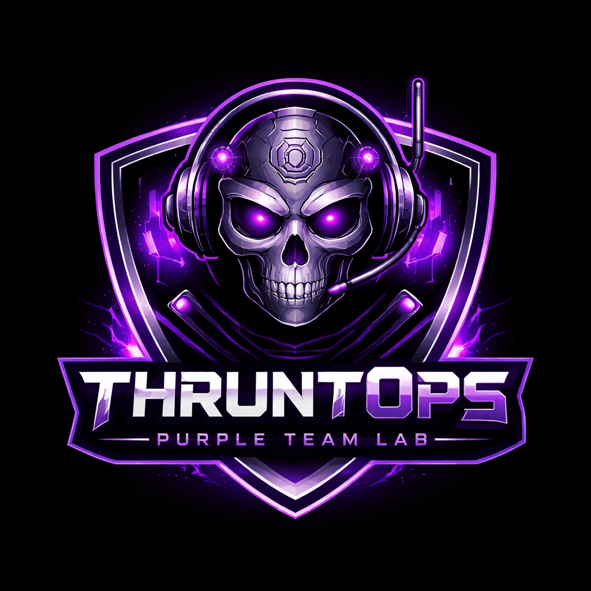

# ThruntOps



A Ludus-based lab for TTP detection testing: one SIEM, one Active Directory domain, one workstation, and one attacker box.

## Scope

The active range profiles are the 2022 baseline: Windows Server 2022 DC (`thruntops.domain`), Windows 11 22H2 workstation, Kali attacker VM, and one SIEM VM. Choose Elastic, Wazuh, or Splunk. The three checked-in profiles are `ranges/elk-base-2022.yml`, `ranges/wazuh-base-2022.yml`, and `ranges/splunk-base-2022.yml`.

Credential-access and ADCS exercises are opt-in. Local ThruntOps AD scenario roles are applied manually to an already-deployed range using `scripts/thruntops-scenarios.py`; they are not part of the base deployment.

Deployed on Proxmox via [Ludus](https://docs.ludus.cloud) on VLAN 20 (`10.<range>.20.0/24`).

## Backends

| Backend | Config | SIEM | VMs |
|---|---|---|---|
| [Elastic](https://enonethreezed.github.io/ThruntOps/elastic) | `ranges/elk-base-2022.yml` | Elastic Stack + Fleet | 4 |
| [Wazuh](https://enonethreezed.github.io/ThruntOps/wazuh) | `ranges/wazuh-base-2022.yml` | Wazuh all-in-one | 4 |
| [Splunk](https://enonethreezed.github.io/ThruntOps/splunk) | `ranges/splunk-base-2022.yml` | Splunk Enterprise | 4 |

All backends share the same four-node topology and are managed with:

```bash
./siem.sh <deploy|start|stop|check|status> <elastic|wazuh|splunk>
./siem.sh deploy splunk --license /path/to/Splunk.License
```

## Users

See the [Users reference](https://enonethreezed.github.io/ThruntOps/users) for the full credentials reference.

## Installation

See the [Installation guide](https://enonethreezed.github.io/ThruntOps/install) for full setup instructions.

## Scenario profiles

The scenario catalog, prerequisites, commands, cleanup guidance, and explicit
limitations are documented in the [AD scenario guide](https://enonethreezed.github.io/ThruntOps/vulnerabilities).
List the available CLI entries with:

```bash
python3 scripts/thruntops-scenarios.py list
```

Applying scenarios is an intentional state change to the lab. The CLI previews
the selected roles and hosts and requires confirmation; it does not redeploy or
destroy the range. Restore a snapshot or use documented cleanup to return to
baseline.

## Status

Repository and deployment status is tracked in the [project status page](https://enonethreezed.github.io/ThruntOps/status). Static tests and the documentation build have passed in recent checks; live validation is separate and remains pending for several project items.
