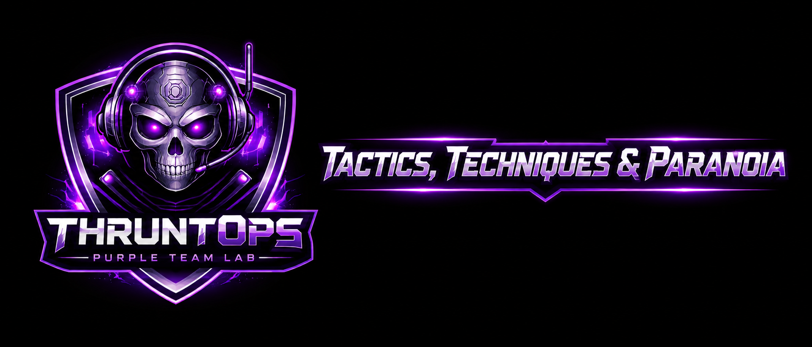

A Ludus-based lab for TTP detection testing: one SIEM, one Active Directory domain, one workstation, one attacker box.

Deployed on Proxmox via [Ludus](https://docs.ludus.cloud). The checked-in active range profiles use the 2022 AD baseline with a choice of SIEM backend. Vulnerability scenarios are applied separately and manually after deployment.

## Backends

| Backend | Config | SIEM | VMs |
|---|---|---|---|
| [Elastic](elastic/) | `ranges/elk-base-2022.yml` | Elastic Stack + Fleet | 4 |
| [Wazuh](wazuh/) | `ranges/wazuh-base-2022.yml` | Wazuh all-in-one | 4 |
| [Splunk](splunk/) | `ranges/splunk-base-2022.yml` | Splunk Enterprise | 4 |

All backends share the same four-node topology (SIEM, DC01-2022, WIN11-22H2-1, Kali) and are managed with the unified `siem.sh` script:

```bash
./siem.sh deploy elastic
./siem.sh deploy wazuh
./siem.sh deploy splunk
```

## Current project status

The three checked-in backend profiles share the same four-node topology. Static
tests and the site build pass; this does not imply that every backend or
scenario has been validated live. Validation of the Splunk Sysmon collection
fix on Windows member hosts is underway. See the [project status page](status/).

→ [Installation](install/) · [Users](users/) · [Kali](kali/) · [Vulnerability Provision](vulnerability-provision/) · [Vulnerabilities Check](vulnerability-check/) · [AD Vulnerability Scenarios](vulnerabilities/) · [Project Status](status/)
