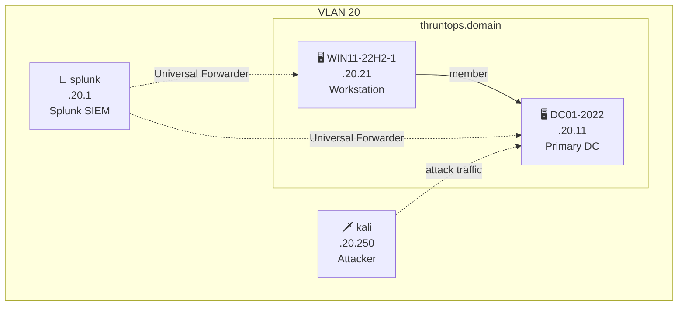

# Splunk Backend
{: .no_toc }

Splunk Enterprise SIEM with a single 2022 AD domain, a Windows 11 workstation, and a Kali attacker VM.
{: .fs-6 .fw-300 }

---

## Table of contents
{: .no_toc .text-delta }

1. TOC
{:toc}

---

## Infrastructure

All VMs run on VLAN 20.

| IP | Hostname | OS | Role |
|---|---|---|---|
| .20.1 | splunk | Ubuntu 24.04 | SIEM — Splunk Enterprise |
| .20.11 | DC01-2022 | Windows Server 2022 | Primary DC — `thruntops.domain` |
| .20.21 | WIN11-22H2-1 | Windows 11 22H2 | Workstation — `thruntops.domain` |
| .20.250 | kali | Kali Linux | Attacker box |

> IP prefix depends on the Ludus range network (e.g. `10.1.0.0/16` → `10.1.20.x`).

---

## Network Diagram



---

## Credentials

| Service | URL | User | Password |
|---|---|---|---|
| Splunk Web | `http://<range_ip>.20.1:8000` | `admin` | `thisisapassword` (set in `ranges/splunk-base-2022.yml`) |

Domain and local accounts use Ludus defaults — see [Users](users.md).

---

## Deployment

```bash
./siem.sh deploy splunk   # ranges/splunk-base-2022.yml
./siem.sh deploy splunk --license /path/to/Splunk.License
```

The optional `--license` argument accepts a local Splunk license file. After
deployment completes, `siem.sh` posts its XML contents to the Splunk Enterprise
REST API at port 8089 using the configured Splunk admin credentials. The API
user must have the `license_edit` capability. The license is not copied to the
Ludus server.

Or step by step:

```bash
ludus range destroy
ludus range config set -f ranges/splunk-base-2022.yml
ludus range deploy
ludus range logs -f
```

---

## Verify

```bash
./siem.sh check splunk
./siem.sh status splunk
```

Or manually via Splunk Web:

- **Settings → Forwarding and receiving → Forwarder management** — both Windows VMs should appear
- **Search:** `index=windows earliest=-15m` — Windows Event Logs from `DC01-2022` and `WIN11-22H2-1`

Check range status:

```bash
ludus range status
```

---

## Sysmon collection diagnostics

The project has an open issue (`ThruntOps-m13`): Sysmon events are present on
domain controllers but missing from `index=sysmon` on Windows member machines.
The Universal Forwarder logs `errorCode=5` (`ERROR_ACCESS_DENIED`) when it
subscribes to `Microsoft-Windows-Sysmon/Operational`. Wazuh has previously
collected this same channel successfully on the workstations, so this is not
known to be a general Windows 11 or Sysmon-channel failure.

### Collect diagnostics

Run the read-only collector from an elevated PowerShell prompt on each affected
member host and a DC for comparison. If the script is on the user's Desktop:

```powershell
Set-ExecutionPolicy -Scope Process Bypass
& "$env:USERPROFILE\Desktop\diagnose-splunk-sysmon.ps1"
```

The script is also available at `scripts/diagnose-splunk-sysmon.ps1`. It records
the service identity and SID settings, local Event Log Readers membership,
channel metadata/ACL, a direct read test under the current elevated user,
effective UF inputs/outputs, relevant logs, and Sysmon state. It does not change
the service, configuration, or ACLs. It writes a timestamped directory and ZIP
in the current directory. Redact host names, domain details, file paths, and
event messages before sharing.

### Latest DC/WIN11 comparison

Collected from `tla-ad-win11-22h2-enterprise-x64-1` and
`tla-ad-dc-win2022-server-x64` in range `tla` on 2026-10-29:

- On both hosts, Sysmon64 was running, the channel was enabled and contained
  events, and its ACL was identical. The ACL grants full access to `SYSTEM` and
  Administrators and read access to the Event Log Readers SID.
- On WIN11, Splunk UF 10.2.1 ran as `NT SERVICE\SplunkForwarder`, the Sysmon
  input was enabled for `index=sysmon`, and the log contained subscription
  failures with `errorCode=5`. Event Log Readers existed but was empty.
- On the DC, Splunk UF 10.2.1 ran as `LocalSystem`; Event Log Readers was not
  found and no matching subscription errors appeared in the collected logs.
- The Splunk service SID type was `NONE` on both hosts. A direct read as
  elevated `domainadmin` succeeded on both, but does not test the service token.

The service identity explained the difference: the DC uses `LocalSystem`,
which is permitted by the channel ACL; WIN11 uses the virtual service identity.
On WIN11, adding `NT SERVICE\SplunkForwarder` to the existing `Event Log
Readers` group and restarting the service cleared the failure. A subsequent
`./siem.sh check splunk` passed and reported fresh Sysmon events from both
Windows hosts. No DC changes were needed.

The latest Ludus deployment log did not show the repository role's grant task,
so the range appears to have used a stale cached `ludus_splunk_uf` role. The
current WIN11 fix is live, but future deployments need the updated role synced
and verified. The collector emitted a non-fatal duplicate `StartName` selection
warning; service identity was still captured by other commands.

## Notes

- Verify that `index=sysmon` exists on the Splunk server and that Windows
  forwarders are connected before attributing missing data to event access.
- Confirm source and host values when searching; see [Verification](#verify).
